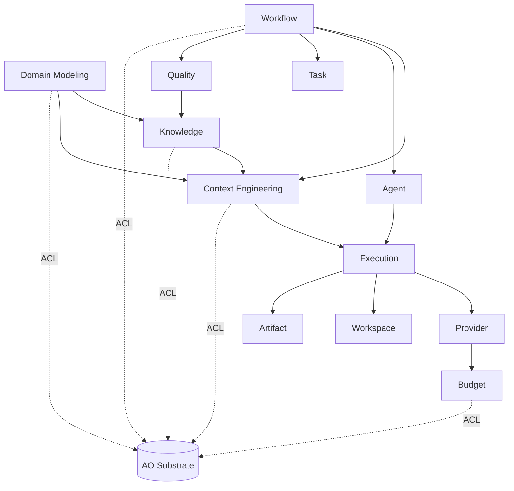

# Bounded Context Map

File này là nguồn duy nhất của danh sách context. Cột Context là tên dùng nguyên văn ở 05, 06 và 14; cột Package là đường dẫn dưới `backend/`. Loại "mới" khớp với `NewContexts` trong `backend/internal/archtest/rules.go`. Cột "Nguồn AO" trỏ tới cụm tính năng trong [[17-feature-code-map]].

## Context

| Context | Package | Loại | Nguồn AO |
|---|---|---|---|
| Domain Modeling | `internal/domainmodel` | mới | F-20 |
| Knowledge | `internal/knowledge` | mới | F-21 |
| Context Engineering | `internal/context` | mới | F-22 |
| Workflow | `internal/workflow` | mới | F-12, F-23 |
| Budget | `internal/budget` | mới, bọc AO | F-04 |
| Agent | `internal/agent` | bọc AO | F-02 (agentlaunch, service/agent) |
| Execution | `internal/execution` | giữ AO | F-01, F-02, F-16 |
| Workspace | `internal/workspace` | giữ AO | F-01 |
| Provider | `internal/provider` | bọc AO | F-03 |
| Quality | `internal/quality` | bọc AO | F-05, F-18 |
| Artifact | `internal/artifact` | giữ AO | F-09 |
| Identity | `internal/identity` | giữ AO | F-06, settings |
| Task | `internal/task` | giữ AO | F-07 |
| Skill | `internal/skill` | bọc AO | F-08 |
| Notification | `internal/notification` | giữ AO | F-10 |
| Audit | `internal/audit` | giữ AO (local) | F-17 |

- **mới:** viết sạch theo bốn tầng `domain/application/infrastructure/interfaces`. Muốn chạm AO thì phải đi qua `infrastructure/acl`.
- **bọc AO:** context có model riêng, còn dữ liệu và hành vi cũ vẫn do code AO giữ, đứng sau một port.
- **giữ AO:** code AO được dời nguyên vào package này ở P3b, theo thứ tự §5 của 17.
- **AO Substrate:** toàn bộ package AO chưa dời (`internal/service/**`, `session_manager`, `httpd`, `adapters/**`…). Nó không phải một context, mà là phần nền context mới dựa vào.

## Sơ đồ

## Hợp đồng

| Upstream → downstream | Contract |
|---|---|
| Domain Modeling → Knowledge | Domain ID, glossary, rule reference |
| Knowledge → Context Engineering | Published revision, evidence, access scope |
| Workflow → Agent | Execution request, input schema, policy |
| Workflow → Execution | ExecutionRequest qua ACL; một Agent Run ứng với một AO Session |
| Execution → Workflow | Sự kiện `change_log` của AO (`session_*`, `pr_*`) được ACL dịch thành event v1 (05) |
| Execution → Provider | Capability request, budget reference |
| Provider → Budget | Reserve, settle, release; usage AO đọc qua ACL |
| Quality → Knowledge | Validated proposal, evidence |

Dùng published language và Anti-corruption Layer cho CLI, Obsidian, API ngoài và AO Substrate. Không chia sẻ aggregate mutable giữa các context, chỉ trao đổi ID, DTO và event.

## Luật import

`backend/internal/archtest` kiểm các luật này trong `go test`:

- **R1:** context mới chỉ import chính nó, `platform/**`, `integrations/**` và module ngoài. Chỉ `infrastructure/acl/**` được import AO. Context mới không import lẫn nhau (v1).
- **R2:** `platform/**` và `integrations/**` không import context mới.
- **R3:** ngoài chính context đó, không ai import `acl` của nó.
- **R4:** ra khỏi `acl`, context mới không import store SQLite hay CDC của AO (`AOSubstratePackages`). Context mới nhận `*sql.DB` và tự sở hữu bảng của mình.

## Thứ tự ưu tiên nguồn

**Trạng thái: đề xuất, chờ chủ sản phẩm duyệt.**

| Câu hỏi | Thứ tự (cao → thấp) |
|---|---|
| Hệ thống **phải** làm gì | Requirement / Business Rule APPROVED → code + test → Knowledge Document DRAFT/IN_REVIEW → suy luận AI |
| Hệ thống **đang** làm gì | Code + test → log → tài liệu |

- Suy luận AI không bao giờ tự thành Business Rule APPROVED.
- Khi một rule APPROVED mâu thuẫn với code, hệ thống không tự chọn bên nào. Context Package ghi mâu thuẫn vào `unresolved_conflicts` ([[10-context-engineering]]), và node tạo Knowledge Proposal hoặc dừng ở Approval.
- Vault không bị ghi đè ([[08-knowledge-architecture]]).

## Chờ quyết

- Scheduling (F-11, Automation/Cues): giữ thành context hay xoá. Route UI đang ẩn.
