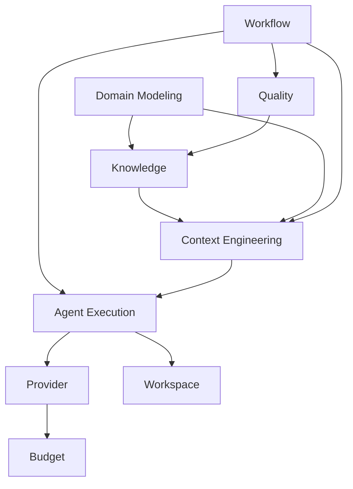

# Bounded Context Map

| Upstream → downstream | Contract |
|---|---|
| Domain → Knowledge | Domain ID, glossary, rule reference |
| Knowledge → Context | Published revision, evidence, access scope |
| Workflow → Agent | Execution request, input schema, policy |
| Agent → Provider | Capability request, budget reference |
| Provider → Budget | Reserve, settle, release |
| Quality → Knowledge | Validated proposal, evidence |

Dùng published language và anti-corruption layer cho CLI, Obsidian, external API. Không chia sẻ aggregate mutable giữa context; chỉ trao đổi ID, DTO và event.
