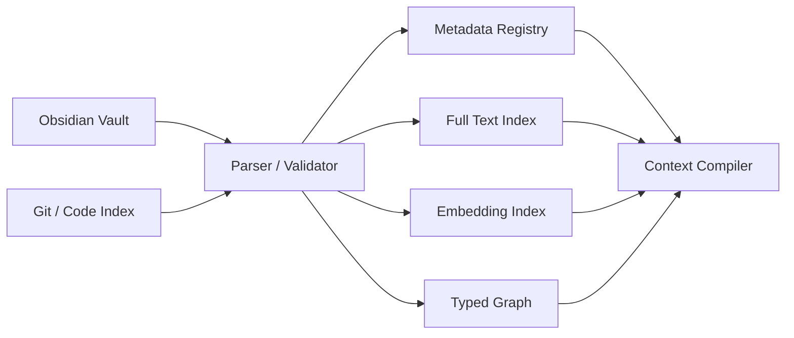

# Knowledge Architecture

Vault Markdown là nguồn tài liệu có version; database và vector index là projection có thể tái tạo. Source code và requirement gốc vẫn là nguồn evidence độc lập.

Typed edge: belongs_to, implements, depends_on, validates, contradicts, supersedes, references. Mỗi edge có source, revision và trạng thái xác thực; backlink Obsidian không tự động trở thành quan hệ nghiệp vụ.

Ingestion: watch → debounce → parse → validate → hash → index → publish index snapshot. Xử lý rename bằng stable ID, deletion bằng tombstone, lỗi parse bằng quarantine. ACL áp dụng trước retrieval và graph traversal.

Lifecycle: discover → draft → review → approved → publish → consume → propose update. STALE là tín hiệu cần kiểm tra, không tự động phủ nhận rule. Conflict không tự động ghi đè.
