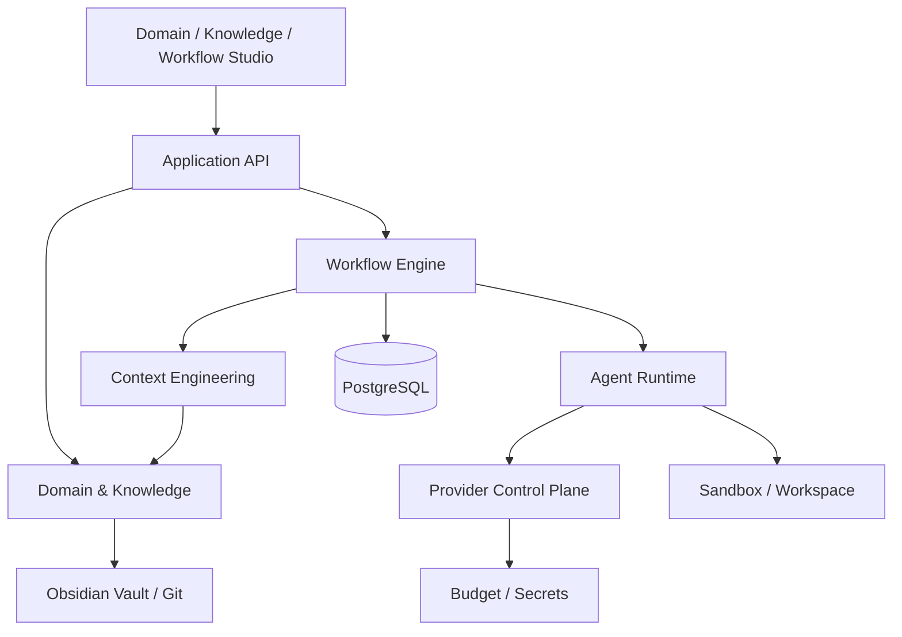

# System Architecture

Đề xuất Modular Monolith, có worker riêng khi cần. Go + React/TypeScript + PostgreSQL là lựa chọn sơ bộ, phải đối chiếu stack repository hiện tại trước khi quyết định rewrite. FTS trước pgvector; typed graph bằng relational tables; chưa cần Neo4j/Kafka.

Module layout: internal/domainmodel, knowledge, context, workflow, agent, execution, provider, budget, workspace, quality, artifact, identity; integrations/obsidian, git, claude, codex, gemini; platform/persistence, eventbus, sandbox, secrets, observability.

API hướng resource: /projects, /domains, /knowledge/documents, /knowledge/proposals, /workflows, /workflow-runs, /agents, /provider-profiles. Command endpoints cho publish, approve, cancel, resume; idempotency key và optimistic concurrency.

UI: Domain Studio, Knowledge Studio, Workflow Studio, Agent Office, Task Board, Unified Terminal, Diff Review, Provider Center, Analytics. UI không trực tiếp đọc secrets.

Security: threat model prompt injection, malicious repo, tool escalation, secret leakage, cross-project retrieval, supply chain. RBAC, sandbox, audit, data egress controls, backup/restore. Observability: correlation ID, run trace, node duration, cost/task, provider errors; redact sensitive data.
