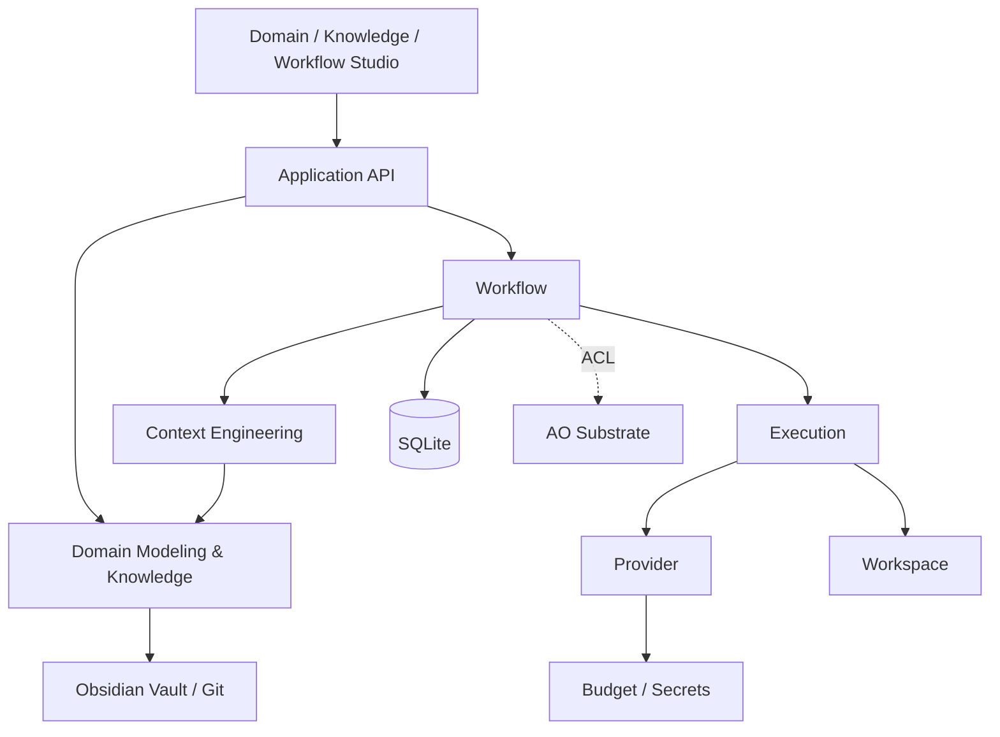

# System Architecture

Modular monolith trong một daemon Go. Frontend là Electron + React/TypeScript. Lưu trữ dùng SQLite: query viết bằng sqlc, migration dùng goose và nằm ở `backend/platform/persistence/sqlite/migrations`. Tìm kiếm dùng FTS5; embedding để sau, khi đã có bộ câu hỏi đánh giá retrieval ([[10-context-engineering]]). Typed graph dựng bằng bảng quan hệ, chưa cần Neo4j hay Kafka. Lý do chọn SQLite thay cho Postgres ở [[16-assessment-and-build-plan]] §S1.

AO Substrate chạy chung tiến trình với các context mới. Context mới gọi nó qua ACL ([[04-bounded-context-map]]) và phát event theo chuẩn event v1 ([[05-event-storming]]).

Module layout: internal/domainmodel, internal/knowledge, internal/context, internal/workflow, internal/budget, internal/agent, internal/execution, internal/workspace, internal/provider, internal/quality, internal/artifact, internal/identity, internal/task, internal/skill, internal/notification, internal/audit; integrations/obsidian, git, claude, codex, gemini; platform/persistence, eventbus, sandbox, secrets, observability.

API hướng resource: /projects, /domains, /knowledge/documents, /knowledge/proposals, /workflows, /workflow-runs, /agents, /provider-profiles. Publish, approve, cancel, resume dùng command endpoint, có idempotency key và optimistic concurrency.

UI: Domain Studio, Knowledge Studio, Workflow Studio, Agent Office, Task Board, Unified Terminal, Diff Review, Provider Center, Analytics. UI không đọc trực tiếp secret.

Security: threat model gồm prompt injection, malicious repo, tool escalation, secret leakage, cross-project retrieval, supply chain. Biện pháp: RBAC, sandbox, audit, data egress controls, backup/restore.

Observability: correlation ID, run trace, node duration, cost/task, provider errors; redact sensitive data.
