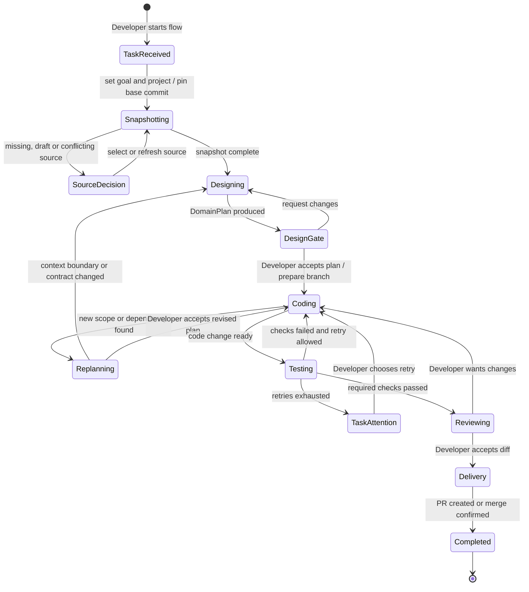
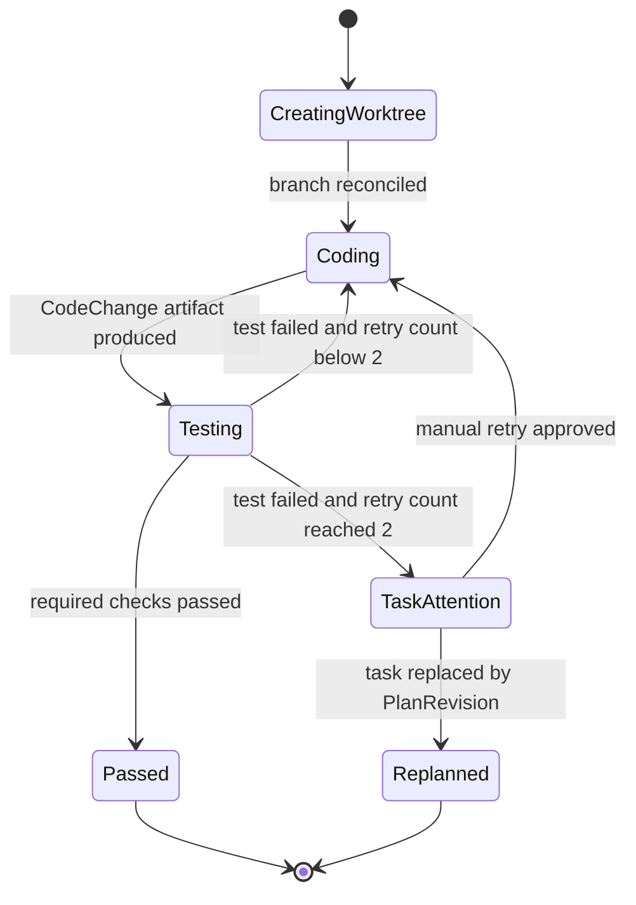
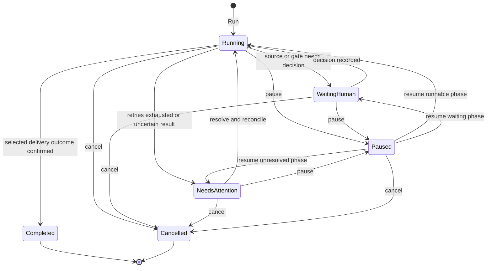

# State machine: mission CMS Permission Review

**Flow cụ thể:** một Developer nhận việc thay đổi quyền miniapp trong `ddd-eda-lab`, đọc spec CMS và profile DDD, tự xem lại Domain Plan, code trên **một branch/worktree**, chạy domain/architecture/contract tests, tự review diff rồi tạo PR hoặc merge theo lựa chọn. Agent có thể hỗ trợ từng bước; không cần một đội nhiều người. Đây là **thiết kế hành vi**, chưa phải AO runtime.

## Actor của flow

Tạm thời chỉ có **một actor người dùng: `Developer`**. Developer làm mọi thao tác chủ động: dựng/sửa flow, chọn nguồn, Run, xem lại hoặc sửa Domain Plan, code hoặc nhờ agent code, retry/pause/resume/cancel, tự review và giao kết quả. Các agent mang role `DDD Analyst`, `Implementer`, `Reviewer` là trợ lý tùy chọn; AO daemon chuyển state; CI/Git trả trạng thái kiểm chứng. Agent và hệ thống không tự thông qua checkpoint. `Admin`/`Developer` trong nghiệp vụ CMS là khái niệm domain của sản phẩm đang xây, không phải phân quyền của Flow Builder.

## 1. FlowRun: trạng thái nghiệp vụ

`DesignGate`, `SourceDecision` và `TaskAttention` là checkpoint **chờ chính Developer**, không phải chờ người ở vai trò khác. `Coding` mặc định dùng một branch/worktree. Nếu Developer chủ động chia task, `Coding` trở thành phase tổng hợp các `TaskRun`; chỉ sang `Reviewing` khi tất cả task bắt buộc đã qua test.

`Replanning` tạo `PlanRevision` bất biến, ghi graph diff và nguyên nhân. Nếu revision đổi bounded context, invariant hoặc public contract, quay lại `Designing → DesignGate`. Nếu chỉ điều chỉnh cách làm trong phạm vi Domain Plan, Developer xem lại và tiếp tục `Coding`. Revision không sửa `FlowDefinition` gốc của run.

## 2. Một vòng code và test trên branch

Ví dụ Developer sửa `Miniapp`/`Submission` theo invariant trong Domain Plan. Agent Implementer có thể hỗ trợ viết code; Developer vẫn sở hữu branch và quyết định sửa gì. Chỉ khi Developer chọn chia việc mới có thêm TaskRun/worktree riêng.

`Testing` phải chạy lệnh thật của project profile trên đúng commit/worktree; lưu `TestReport` với command, exit code và log. Khi fail, feedback quay về **cùng branch và bước code**. `TaskAttention` không tự retry nữa. Worker chết hoặc daemon restart thì reconcile session, branch và worktree đã có trước khi chạy tiếp; không tự tạo bản trùng.

Task `Replanned` chỉ được loại khỏi tập task bắt buộc sau khi `PlanRevision` đã được duyệt và task thay thế đã được tạo; nó không được tính là `Passed` tại node `join`.

## 3. Điều khiển vận hành

`pause`, `resume`, `cancel` áp dụng cho mọi phase chưa kết thúc. Chúng là **runtime status độc lập với phase**: `running → paused → running` (resume tại phase/node đã lưu), `running|paused|waiting_human → cancelled`. `cancelled` và `completed` là terminal. Pause không hủy worktree hoặc quyết định gate. Cancel dừng dispatch mới, yêu cầu dừng worker đang chạy và giữ artifact/log để audit. Lỗi hạ tầng có kết quả commit chưa rõ đưa run vào `needs_attention`; thao tác `reconcile` phải kiểm tra sự thật hiện có trước khi retry.

## 4. Guard và artifact trên các chuyển trạng thái chính

| Transition | Điều kiện bắt buộc | Dữ liệu lưu |
|---|---|---|
| `TaskReceived → Snapshotting` | Definition hợp lệ; Developer nhập mục tiêu và chọn project; knowledge/test commands được cấu hình | Definition version, task brief, project/base commit, Developer ID |
| `Snapshotting → Designing` | Nguồn bắt buộc đọc được; xung đột được giải quyết | `KnowledgeSnapshot` với URI/ref/hash và trạng thái draft |
| `DesignGate → Coding` | Developer chấp nhận Domain Plan; thay đổi boundary/contract đã được thấy | `CheckpointDecision`, Developer ID, DomainPlan version/hash, branch intent |
| `Coding → Testing` | Branch/worktree sẵn sàng; code change được lưu | `CodeChange`, commit/diff ref |
| `Testing → Reviewing` | Domain, architecture và affected contract tests có report đạt; nếu chia task thì mọi task bắt buộc đạt | `TestReport`, commit refs |
| `Reviewing → Delivery` | Developer xem diff và chấp nhận kết quả; CI hiện hành đạt nếu policy yêu cầu | `ReviewDecision`, Developer ID, PR/CI refs |
| `Delivery → Completed` | Theo lựa chọn: PR tạo thành công **hoặc** provider xác nhận merge trên đúng PR/head | Delivery outcome, PR URL hoặc merge commit |

Mỗi transition ghi `expected_version` của `FlowRun` và idempotency key. Stale gate click, webhook CI lặp hoặc resume sau restart không được tạo hai transition/worker/PR. Mission Control hiển thị phase, runtime status, task con, attempt/retry, người đang chờ, source snapshot, diff, test và quyết định gate.
