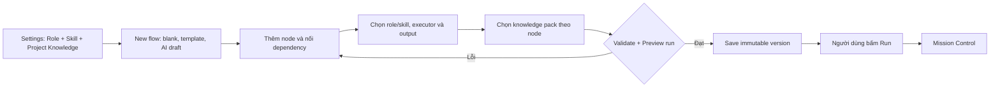
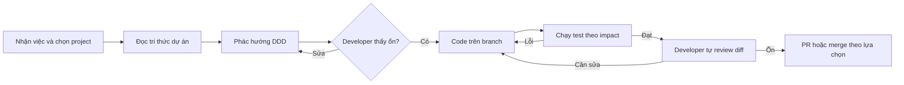

# Flow Builder: tự dựng flow → gán role và tri thức → Run

**Quyết định sản phẩm:** preset đầu tiên mô hình hóa **một vòng làm việc của một Developer**. Engine dùng [mô hình participant đa vai trò](./role-skill-knowledge-model.md): về sau cùng một người/AI có thể làm PO, BA, SA, Dev, Test với skill, năng lực và tri thức dự án tương ứng. Người dùng tự dựng hoặc nhờ AI phác flow, kiểm tra rồi chủ động bấm Run. Đây là năng lực **cần xây** cho AO; AO hiện có session/worktree và PR/CI để làm executor, chưa có flow definition/run engine tương ứng.

## 1. Trải nghiệm chính



**Actor người dùng của preset đầu tiên là một `Developer`**: nhận việc, tạo/sửa flow, chọn tri thức, bấm Run, xem lại kế hoạch, code hoặc giao agent hỗ trợ, xử lý test lỗi, tự review và quyết định giao kết quả. Core engine lưu `participant_id` và role binding theo node, **không hardcode `Developer`**. Role (`DDD Analyst`, `Implementer`, `Test Engineer`, `Reviewer` ở preset này; PO/BA/SA ở preset khác) là mũ công việc. Mỗi bước chọn `manual` (người làm và nộp artifact), `agent` (agent thực thi) hoặc `assisted` (agent đề xuất, người chấp nhận). AO daemon và CI/Git thực thi/trả kết quả, không quyết định thay participant.

**Knowledge pack** chọn nguồn theo project hoặc node: repo/ref, tài liệu, ADR, issue, DDD profile. Node chỉ nhận phần tri thức được cấp; khi Run, AO tạo snapshot có hash/ref và hiện cảnh báo nguồn draft, stale hoặc xung đột. Output node trước đi qua artifact refs có provenance.

Role, Skill và Project Knowledge được quản lý trong [Settings riêng](./settings-role-skill-project-knowledge.md). Flow Builder tham chiếu bản đã lưu rồi cho override theo node; khi Run, AO ghim các version/hash. Không phải khai báo lại tất cả trong mỗi flow.

## 2. Các node đầu tiên

| Loại node | Vai trò | Đầu ra |
|---|---|---|
| `work` | Developer tự làm, agent làm hoặc hai bên phối hợp ở Research/DDD/code/review | Artifact theo schema; session/worker khi có agent, diff khi có code |
| `gate` | Developer accept/request changes cho đầu ra cần xem lại | Decision và feedback có audit |
| `test` | Chạy lệnh trong project profile trên đúng branch/worktree | TestReport, exit code, log |
| `join` | Chờ mọi nhánh bắt buộc và tổng hợp kết quả | Tập artifact đầu vào đã đạt |

Mặc định một flow dùng **một branch/worktree** cho một việc của Developer. Chỉ tách task/worker/branch khi Developer chọn và chúng không trùng file scope/contract. Vòng lặp sửa lỗi là **edge retry có trần**, không cho chu trình vô hạn. Node có thể do Developer thêm thủ công hoặc AI đề xuất; AI draft không tự chạy.

## 3. Mẫu flow DDD cho mục tiêu hiện tại



Nếu Developer bật chế độ chia task, `Planner` được phép đề xuất **task instances** từ Domain Plan; Developer xem lại trước khi AO tạo thêm worker/branch. Planner không được tự tạo node type mới, mở rộng tool permissions hay bỏ gate. Khi cần đổi topology giữa run, tạo `PlanRevision` có lý do và diff, validate lại graph, ghi audit; thay đổi boundary/contract quay lại bước thiết kế. Run đã bắt đầu vẫn ghim definition version ban đầu.

## 4. Contract tối thiểu

```yaml
flow:
  id: ddd-feature-delivery
  version: 1
  project: ddd-eda-lab
  nodes:
    - id: design
      type: work
      execution: assisted
      role: DDD Analyst
      agent: configured-agent-id
      knowledge: [project-specs, ddd-profile]
      output: DomainPlan/v1
    - id: approve-design
      type: gate
      after: [design]
      approver: developer
    - id: implement
      type: work
      execution: assisted
      after: [approve-design]
      role: Implementer
      agent: configured-agent-id
      worktree: per-flow
      knowledge: [ddd-profile, relevant-specs, DomainPlan]
      output: CodeChange/v1
    - id: verify
      type: test
      after: [implement]
      commands_from: project-test-profile
      retry_to: implement
      max_retries: 2
    - id: review
      type: work
      execution: assisted
      after: [verify]
      role: Reviewer
      agent: configured-agent-id
      output: ReviewReport/v1
    - id: deliver
      type: gate
      after: [review]
      approver: developer
      action: create-pr-or-merge
```

Definition là graph hợp lệ theo dependency. Với `execution: manual`, không cần `agent` và Developer trực tiếp nộp artifact; `assisted` cần Developer chấp nhận artifact agent đề xuất. `expand_from: DomainPlan.tasks` là lựa chọn nâng cao để fan-out task sau khi Developer xem lại. Đây là **shape contract**, chưa phải YAML parser hoặc API đã triển khai.

## 5. Validate trước Run

1. Graph có entry/exit, node ID duy nhất, dependency tồn tại; ngoài retry edge có trần thì không có cycle; mọi nhánh cần `join` hoặc exit rõ ràng.
2. Mỗi `work` node có role binding, skill version, capability cần thiết, execution mode, input/output schema, knowledge scope và policy timeout/retry; `agent`/`assisted` cần agent/model và tool permissions khả dụng. Trong preset Dev, gate trỏ tới participant Developer đang chạy flow.
3. Project repo/base commit và knowledge snapshot đọc được; source draft/xung đột được đánh dấu để người dùng xử lý.
4. Task code có branch/worktree policy; các task song song có file ownership và contract dependency rõ; test node có lệnh thực, không báo pass nếu chưa chạy.
5. Preview cho thấy graph thực thi, node nào chờ người, số worker tối đa, nhánh có thể chạy song song và chi phí ước lượng nếu có dữ liệu. Không chạy hoặc tạo worker ở bước Preview.

## 6. Mission Control và lưu trạng thái

`FlowDefinition(version)` → `FlowRun` → `NodeRun/TaskRun` → `Artifact` + `GateDecision` + `PlanRevision`. Mỗi run ghim definition version, project/base commit, knowledge snapshot và DDD profile. Daemon sở hữu scheduler/state; node agent dùng AO Session Manager, node code dùng worktree hiện có; UI hiển thị graph runtime, attention, log, test, branch và PR. Resume sau restart phải reconcile worker/branch/PR trước khi tạo mới.

## 7. Cách triển khai thành từng lát

| Lát | Có thể dùng được khi xong |
|---|---|
| 1. Settings | Tạo Role/Skill versioned và Project Knowledge từ local repo/files, preview nguồn. |
| 2. Definition + validator + form editor | Developer dựng graph từ 4 node type, chọn manual/agent/assisted, gán role/skill/knowledge từ Settings, save version và preview. |
| 3. Run engine + Mission Control | Bấm Run, daemon ghim cấu hình và chạy node theo dependency, gate chờ người, state bền qua restart. |
| 4. Branch + test | Một Developer làm một việc trên một branch/worktree; test fail quay lại bước code. Chia task/worker là tùy chọn sau. |
| 5. Graph editor + plan revision | Kéo thả canvas và thay graph khi run theo policy; giữ lịch sử revision. |

Mẫu DDD là preset đi kèm, không phải workflow duy nhất. Những project khác có thể tạo flow Research → Docs → Review hoặc Design → Code → Test với cùng engine. Trong mọi flow, Developer nhìn thấy mình đang làm bước nào, trợ lý nào đang hỗ trợ và đầu ra nào đã được chấp nhận.

Xem [state machine CMS Permission Review](./cms-permission-flow-state-machine.md) cho trạng thái và guard của một run cụ thể.
