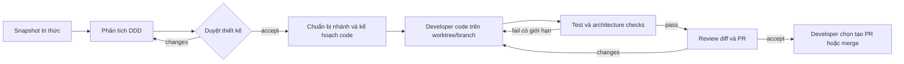

# Workflow tri thức dự án → DDD → code trên nhánh → testing

**Mục tiêu sản phẩm:** hỗ trợ trọn vòng làm việc của **một Developer**: nhận việc, đọc tri thức dự án, nghĩ theo DDD, code trên một branch/worktree, test, tự review và giao kết quả. Agent có thể hỗ trợ ở từng bước; chia nhiều worker/branch là lựa chọn nâng cao. Đây là **preset DDD** của [Flow Builder](./flow-builder.md), chưa phải tính năng AO đã có.

## 1. Nguồn chuẩn và phạm vi áp dụng

Repo tham chiếu do người dùng chỉ định: `/Users/steven/Documents/work/poc/ddd-eda-lab`. Nó cung cấp **mẫu DDD/EDA và các ràng buộc có thể kiểm tra**, không phải template buộc mọi project dùng Java, Scylla hay event store. Profile chuẩn của từng project phải chọn rõ các quy tắc áp dụng.

| Bằng chứng trong repo DDD | Quy tắc đưa vào workflow |
|---|---|
| `docs/specs/cms.md` §3, §5: ngôn ngữ chung, Access/Governance, aggregate, invariant, command → event | Trước khi code phải xác định context, từ vựng, actor, aggregate, invariant, use case, event và ranh giới liên context. |
| `docs/specs/cms.md` §10: domain thuần, repository interface, feature slice, store adapter, endpoint mỏng | Thiết kế phải nêu dependency direction, port/adapter và nơi đặt từng thay đổi. Chỉ áp dụng layout cụ thể khi project chọn profile tương ứng. |
| `coding/backend/services/cms/src/test/java/poc/cms/ArchitectureTest.java` | Chạy architecture test của project; với CMS, domain không import infra/transport và area không import area khác ngoài base cho phép. |
| `coding/backend/services/app-identity/domain/`, `features/sign_in/process.go`, `store/` | Có ví dụ Go: domain/port tách khỏi use case và persistence, business outcome phân biệt lỗi kỹ thuật. |
| `docs/specs/cms.md` §6, §12 | Event store version-CAS, projection idempotent, race, authorization, persistence là **quy tắc riêng CMS/lab**; chỉ đưa vào gate của task đụng các contract này. |

Tại lúc rà soát, `docs/specs/cms.md` và một số spec khác ở repo DDD là **untracked working-tree files**; GitNexus index cũng báo chậm hơn HEAD 7 commit. Vì vậy hệ thống không được gọi chúng là chuẩn đã phát hành. Người dùng có thể chọn `committed ref` hoặc `working-tree snapshot`; Mission Control phải ghi rõ trạng thái nguồn và hash snapshot. Tài liệu có chỉ dẫn ưu tiên nguồn (ví dụ `scyna-architecture-contract.md` nhường chỗ cho fix plan/view docs khi xung đột) phải được áp dụng khi chọn nguồn.

## 2. Một run hoàn chỉnh



| Stage | Input / xử lý | Artifact bắt buộc và gate |
|---|---|---|
| 0. Knowledge snapshot | Project repo/ref, spec/ADR, issue, các file được chọn; resolve ưu tiên nguồn, đánh dấu draft/conflict | `KnowledgeSnapshot`: URI/path, ref hoặc content hash, thời điểm, trạng thái committed/draft, quyền truy cập. Thiếu nguồn bắt buộc hoặc xung đột chưa giải quyết → `needs-attention`. |
| 1. DDD design | Feature brief + snapshot; map bounded context, ubiquitous language, actor, aggregate/invariant, command/event, port/adapter, tác động API/data | `DomainPlan` có source refs cho từng quyết định, open questions, danh sách invariant và acceptance criteria. Developer duyệt khi thay context boundary, public contract hoặc dữ liệu. |
| 2. Code plan | Developer chọn phạm vi sửa, test plan và một branch/worktree; có thể nhờ Planner đề xuất chia task nếu việc lớn | `CodePlan` gồm context, file scope, base commit, dependencies và test plan. Khi chia task, không chạy song song hai task cùng sửa một file/contract chung. |
| 3. Implementation | Developer code hoặc giao agent hỗ trợ trên branch/worktree của flow; truyền `DomainPlan`, nguồn cần thiết, file scope, acceptance | Commit/diff, branch, base commit, session ID nếu có agent, changed files, mô tả domain change. Không ghi vào base branch; agent không tự sửa contract ngoài scope. |
| 4. Verification | Chạy test domain invariant, architecture/import, contract/API, integration và E2E theo change impact; ghi exact command và exit code | `TestReport` gồm pass/fail/skip, log refs, coverage impact và lý do skip. Fail trả về chính task để sửa, có retry cap; quá cap hoặc lỗi môi trường → attention. |
| 5. Self-review / delivery | Developer so diff với `DomainPlan`, kiểm chứng invariant, API/data migration và kết quả test; chọn tạo PR hoặc merge theo policy project | `ReviewDecision` + PR/CI refs nếu có. Không suy ra quyết định giao kết quả từ test xanh. |

### Handoff và tính tái lập

- Mỗi artifact có `run_id`, `stage_id`, schema version, producer, timestamp, source refs và content hash. Stage tiếp theo nhận artifact/ref có provenance kèm tóm tắt ngắn; không bơm nguyên transcript vào prompt.
- `WorkflowRun` ghim definition version, project/base commit, DDD profile version, knowledge snapshot ID, model/agent selection và tool policy. Sau khi chạy, sửa tài liệu nguồn không âm thầm thay đổi context của run; người dùng chọn refresh tạo attempt/snapshot mới.
- Gate ghi `accepted/rejected/needs-human`, người quyết định, feedback và attempt. Retry là có giới hạn; lặp vượt trần thì dừng và chờ người xử lý.
- Stage thực thi phải idempotent sau daemon restart: resume/reconcile session, worktree, branch và PR hiện có trước khi tạo mới.

## 3. DDD profile theo project

Profile không phải prompt tự do. Nó là contract máy đọc được, do project gắn vào workflow definition:

```yaml
project: ddd-eda-lab
knowledge:
  repository: /Users/steven/Documents/work/poc/ddd-eda-lab
  ref_policy: committed-ref-or-explicit-working-tree-snapshot
  sources:
    - docs/specs/cms.md
    - coding/backend/services/cms/src/test/java/poc/cms/ArchitectureTest.java
  conflict_policy: stop-and-request-decision
ddd:
  require:
    - bounded-context-and-language
    - aggregate-invariants
    - command-event-mapping
    - ports-and-adapters
  architecture_checks:
    - project-defined-command
branching:
  mode: worktree-per-flow
  base: pinned-commit
  parallelism: optional-independent-file-scopes-only
verification:
  require: [domain-tests, architecture-tests, affected-contract-tests]
  integration: when-affected
  e2e: when-affected
gates:
  domain-plan: developer-on-boundary-or-contract-change
  test-failure-retries: 2
  delivery: developer-chooses-pr-or-merge
```

`project-defined-command` phải được cấu hình thành lệnh thật sau khi nhận diện build tool của project. AO không đoán lệnh test rồi báo pass. Profile của project khác có thể dùng Go/TypeScript, không kế thừa yêu cầu Scylla/CMS nếu không liên quan.

## 4. Mission Control cần hiển thị

Một mission/run cho thấy: snapshot tri thức và cảnh báo draft/stale, context map và DomainPlan, stage strip, worker/branch/worktree theo task, dependencies, test matrix, PR/CI, retry/gate, người cần quyết định, log và chi phí. Bấm vào một lỗi phải đến đúng source, diff hoặc test log. Các action `approve design`, `retry`, `refresh knowledge`, `request changes`, `create PR`, `merge` đi qua daemon và có audit; UI chỉ là read model.

## 5. Cắt theo lát triển khai trong AO

| Slice | Việc làm | Định nghĩa xong |
|---|---|---|
| 1. Snapshot + DDD plan | Nối project repo/docs đã chọn; lưu snapshot và DomainPlan artifact; Developer design gate | Run hiển thị nguồn, hash/ref, draft/conflict và không code khi gate chưa qua. |
| 2. Workflow tuyến tính | Durable definition/run/stage/decision, resume, retry cap; dùng AO session manager | Restart không sinh worker trùng; mọi handoff audit được. |
| 3. Branch execution | Một branch/worktree cho flow, attach diff/commit; hỗ trợ tách task khi Developer chọn | Một dev chạy trọn vòng trên branch; nếu tách task thì cùng file/contract phải xếp hàng. |
| 4. Test + review | Lệnh test theo profile, report, fail feedback, Developer tự review và chọn giao kết quả | Test đỏ chặn hoàn tất; test skip có lý do; PR/merge chỉ chạy theo lựa chọn và policy. |
| 5. Mission Control | Tổng hợp artifacts, workers, attention và recovery từ durable facts | Từ một run tìm được nguồn tri thức → quyết định DDD → branch → test → PR. |

AO hiện có project/session/worker/worktree/PR/CI và Board để tái sử dụng. `docs/02-architecture/03-pipeline-engine.md` và `07-knowledge-base.md` trong workspace là **thiết kế nháp** cho DAG/RAG, chưa phải runtime. Flow Builder dùng graph definition có dependency/checkpoint; preset DDD mặc định đi theo một nhánh làm việc của Developer. Fan-out task/worker là tùy chọn cho việc lớn. Nối BookStack/Jira/Qdrant là bước mở rộng sau khi local repo/docs snapshot hoạt động ổn.
