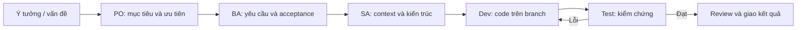

# Mô hình vai trò, skill, năng lực và tri thức dự án

**Định hướng:** Flow Builder phục vụ bất kỳ ai tham gia phát triển sản phẩm, kể cả người và AI. Một participant có thể đảm nhiệm nhiều vai trò **PO, BA, SA, Dev, Test** trong cùng flow. [Flow một Developer](./flow-builder.md) là preset đầu tiên; engine không khóa identity vào `Developer` hay đòi một người khác cho mỗi bước.

## 1. Tách năm khái niệm

| Khái niệm | Câu hỏi nó trả lời | Ví dụ |
|---|---|---|
| `Participant` | Ai đang làm hoặc chịu trách nhiệm bước này? | một người dùng AO, một agent instance |
| `RoleProfile` | Bước này đòi trách nhiệm và đầu ra gì? | BA viết yêu cầu, SA chốt ranh giới kiến trúc |
| `Skill` | Quy trình/công cụ tái sử dụng nào giúp làm việc? | phân tích user story, DDD modeling, test design; mỗi skill có version |
| `Capability` (kĩ năng) | Participant có khả năng thực hiện loại việc nào? | domain modeling, Go backend, API testing; có thể gắn bằng chứng, không mặc định tự chấm điểm |
| `KnowledgePack` | Cần biết gì về **dự án này** để làm đúng? | spec/ADR, code conventions, DDD profile, backlog, API contracts, repo/ref |

**Role không phải account hay quyền duyệt.** Một identity có thể đội nhiều role; quyền thực hiện action và gate là policy riêng. `Skill` là hướng dẫn/quy trình có thể gắn vào node; `Capability` là khả năng của người/agent; `KnowledgePack` là dữ liệu cụ thể của project. Không gộp ba thứ này thành một prompt dài.

Các đối tượng dùng lại được quản lý trong [Settings Role, Skill và Project Knowledge](./settings-role-skill-project-knowledge.md); Flow Builder chỉ gắn chúng vào node và ghi override cần thiết.

## 2. Một flow phát triển sản phẩm



Mỗi ô là **work node với role binding**, không phải một người/agent riêng. Cùng `participant_id` có thể làm PO → BA → SA → Dev → Test; từng node chọn `manual`, `agent` hoặc `assisted`. Tùy việc, Developer preset có thể bắt đầu thẳng từ DDD/Code; flow có thể thêm, bỏ, lặp hoặc chia nhánh theo policy mà không bắt mọi dự án đi qua đủ năm role.

| Role | Artifact điển hình | Skill gợi ý | Tri thức thường cần |
|---|---|---|---|
| PO | Goal, scope, priority, success criteria | discovery, prioritization | strategy, roadmap, stakeholder feedback |
| BA | Requirement, user story, acceptance criteria | elicitation, story slicing | business rules, process, glossary |
| SA | Context map, ADR, contract, risk | DDD modeling, architecture review | architecture, domain boundaries, standards |
| Dev | CodeChange, migration, technical notes | coding, refactoring, debugging | repo, conventions, DomainPlan, API contract |
| Test | TestPlan, TestReport, defect | test design, automation | acceptance criteria, fixtures, test profile |

Đây là **default artifact mapping** để dựng preset; project có thể thay role name, skill và artifact contract.

## 3. Binding lúc dựng flow và lúc Run

```yaml
node:
  id: model-domain
  role: SA
  output: DomainPlan/v1
  execution: assisted
  participant: current-user
  agent: configured-agent-id
  skills:
    - id: ddd-modeling
      version: 2
  capabilities_required: [domain-modeling, architecture-review]
  knowledge:
    - project: ddd-eda-lab
      pack: architecture-and-cms-specs
  checkpoint: participant-accepts-output
```

- **Flow definition** lưu yêu cầu theo role, skill version, capability cần thiết, knowledge scope, artifact contract và gate policy. Nó không buộc mỗi role là một identity khác.
- **Run binding** chọn participant/agent thực tế cho node. Validate kiểm participant có tool/quyền cần thiết và skill/knowledge còn đọc được. Capability thiếu bằng chứng thì báo để người dùng quyết định, không giả vờ hệ thống đã xác thực năng lực.
- **Run snapshot** ghim definition version, role/skill versions, participant binding, project knowledge refs/hashes và artifact versions. Thay skill hoặc tài liệu sau khi Run không âm thầm đổi context giữa chừng.
- **Handoff** chỉ chuyển artifact có schema và provenance; node sau có thể yêu cầu sửa, mở lại bước trước hoặc nhận một `PlanRevision` đã audit.

## 4. Lộ trình áp dụng

1. **Bản đầu:** một Developer là participant người dùng, role Dev/DDD/Test là các mũ trong flow; skill và knowledge gắn theo node, một branch mặc định.
2. **Mở rộng flow sản phẩm:** thêm preset PO → BA → SA → Dev → Test, cho cùng participant làm nhiều role, hỗ trợ agent theo từng bước.
3. **Sau khi có dữ liệu sử dụng:** thư viện RoleProfile/Skill/KnowledgePack dùng lại giữa project, gợi ý assignment theo capability và policy gate theo tổ chức nếu cần.

Mission Control nên hiển thị **bước đang làm, role đang đội, participant/agent đang thực thi, skill/knowledge version và artifact cần xem**. Một người đổi role giữa các bước vẫn giữ cùng identity và lịch sử run.
