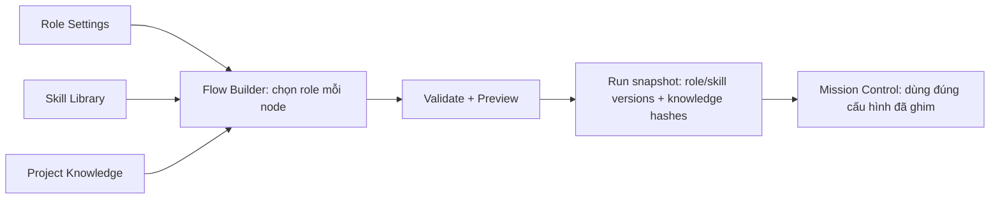

# Settings cho Role, Skill và Project Knowledge

**Mục đích:** cấu hình một lần, dùng lại ở nhiều flow. Flow Builder tham chiếu các bản cấu hình đã lưu; lúc Run, AO ghim phiên bản và snapshot. Đây là thiết kế sản phẩm, chưa phải màn hình AO đã có.

## 1. Cấu trúc Settings

```text
Settings
├─ Roles             PO · BA · SA · Dev · Test · role tự tạo
├─ Skills            kỹ thuật phân tích, DDD, coding, test, review…
└─ Projects
   └─ <Project>
      └─ Knowledge   repo · spec · ADR · backlog · API · DDD profile
```

| Settings | Người dùng chỉnh gì | Kết quả lưu |
|---|---|---|
| **Roles** | Tên, mục tiêu, trách nhiệm, artifact đầu ra, skill mặc định, execution mode gợi ý | `RoleProfile(id, version)`; một participant có thể nhận nhiều role, role không tự cấp quyền duyệt |
| **Skills** | Hướng dẫn thực hiện, input/output contract, tool cần dùng, phạm vi áp dụng, version | `SkillDefinition(id, version)` dùng lại cho nhiều role/node; sửa skill tạo version mới |
| **Project Knowledge** | Nguồn tri thức, phạm vi file, ref/sync policy, độ ưu tiên nguồn, DDD profile, trạng thái draft/stale/conflict | `KnowledgePack(project_id, version)` và `KnowledgeSnapshot` có URI/ref/hash khi Run |

`Capability` (kĩ năng của participant/agent) có thể được khai báo trong profile participant và dùng để cảnh báo assignment thiếu phù hợp. Nó **không thay** Skill Library: Skill Library mô tả *cách làm*, capability mô tả *khả năng làm*. Xem [mô hình khái niệm](./role-skill-knowledge-model.md).

## 2. Màn cấu hình đề xuất

```text
┌─ Settings / Roles ────────────────────────────────────────────────────────┐
│ PO  BA  SA  Dev  Test   [+ New role]                                      │
│ SA / v2  Mục tiêu: chốt ranh giới domain và contract                      │
│ Output: DomainPlan/v1, ADR/v1                                              │
│ Skills mặc định: DDD modeling v2, architecture review v1                 │
│ Knowledge gợi ý: architecture, domain specs                               │
└───────────────────────────────────────────────────────────────────────────┘
┌─ Settings / Skills ───────────────────────────────────────────────────────┐
│ DDD modeling / v2     Input: brief + specs     Output: DomainPlan/v1      │
│ Hướng dẫn · tool requirements · test/checklist · lịch sử phiên bản        │
└───────────────────────────────────────────────────────────────────────────┘
┌─ Project / Knowledge ─────────────────────────────────────────────────────┐
│ ddd-eda-lab                                                              │
│ Repo: ref đã ghim       Specs: 12 nguồn      ADR: 4 nguồn                  │
│ DDD profile: v1         Draft: 1 ⚠           Conflict: 0                  │
│ [Preview nguồn] [Sync] [Tạo snapshot thử]                                 │
└───────────────────────────────────────────────────────────────────────────┘
```

Các con số và version trong wireframe chỉ minh họa. `Project Knowledge` phải hiển thị nguồn cụ thể, quyền đọc, ref/hash và xung đột; trạng thái `Sync succeeded` không tự khẳng định nội dung là chuẩn đã duyệt.

## 3. Từ Settings đến Run



1. Chọn role cho node → tự điền artifact contract, skill mặc định và knowledge gợi ý từ `RoleProfile`.
2. Người dùng thêm/bỏ skill hoặc giới hạn knowledge của **node này**. Override được ghi trong `FlowDefinition`; không sửa ngầm RoleProfile hay KnowledgePack gốc.
3. Validate kiểm skill version tồn tại, tool/agent phù hợp, source tri thức đọc được, output contract khớp node kế tiếp và checkpoint có actor/policy.
4. Preview cho xem role, executor (`manual/agent/assisted`), skill, knowledge và artifact đầu ra của từng bước. Bấm Run mới tạo `KnowledgeSnapshot` và `FlowRun`.
5. Sau Run, Settings đổi version mới không đổi run cũ. Muốn dùng bản mới phải tạo run khác hoặc refresh có `PlanRevision` và quyết định của participant.

**Thứ tự ưu tiên:** node override → role default → project default. `Project Knowledge` luôn bị giới hạn theo project và quyền truy cập; node override chỉ thu hẹp/chọn nguồn, không mở nguồn của project khác. Quyền thực hiện action/gate theo policy riêng, không suy ra từ tên role.

## 4. Lát triển khai đầu tiên

1. Lưu RoleProfile và SkillDefinition versioned, Project Knowledge từ local repo/files, xem preview nguồn.
2. Flow Builder chọn role/skill/knowledge đã lưu, hỗ trợ override theo node và validate trước Run.
3. Run snapshot ghim role/skill versions và knowledge refs/hashes; Mission Control cho mở lại đúng cấu hình đã dùng.

BookStack/Jira và tìm kiếm ngữ nghĩa có thể nối vào Project Knowledge sau; local repo/spec/ADR đủ để kiểm chứng vòng đầu. Preset Dev dùng các Settings này trước, sau đó thêm preset PO → BA → SA → Dev → Test mà không đổi mô hình dữ liệu cốt lõi.
