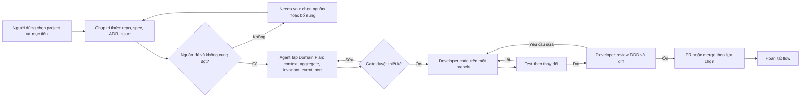
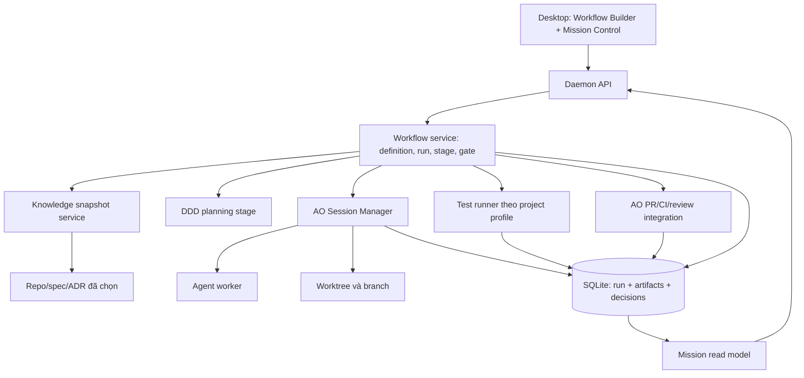

# Bản vẽ phương án: Project Knowledge → DDD → Branch → Test

**Trạng thái:** phương án sản phẩm và kiến trúc để thảo luận trước khi triển khai. Kế thừa [đặc tả use case](./project-knowledge-ddd-workflow.md) và [Workflow/Mission Control](./workflow-mission-control.md).

**Cập nhật phạm vi:** đây là một **preset DDD cho một Developer** của [Flow Builder tùy biến](./flow-builder.md). Developer tự đi qua các bước; role agent là trợ lý theo bước. Mặc định một việc trên một branch. Chia task/worker chỉ khi Developer chọn.

## 1. Luồng một mission



Developer có thể gắn agent hỗ trợ thiết kế, code, test hoặc review ở từng bước. Nếu chọn tách việc, các worker chỉ chạy song song khi file scope và contract không chồng nhau; task đụng cùng aggregate, API contract hoặc migration phải có thứ tự phụ thuộc.

## 2. AO sẽ nối các thành phần như thế nào



**Nguyên tắc sở hữu:** daemon điều phối và lưu sự thật; Session Manager hiện có tạo worker/worktree; frontend chỉ hiển thị và gửi action. Knowledge snapshot là đầu vào có phiên bản, không phải một prompt dài không truy vết được.

## 3. Phác màn Mission Control

```text
┌─────────────────────────────────────────────────────────────────────────────┐
│ Project: ddd-eda-lab  /  Mission: CMS permission review       [Pause] [⋯]  │
├─────────────────────────────────────────────────────────────────────────────┤
│ Nhận việc ✓ → Tri thức ✓ → DDD ✓ → Code ● → Test ○ → Review ○ → Giao kết quả ○│
│ Snapshot: commit 4d6f14f + 1 draft file  ⚠  |  Profile: DDD v1             │
├─────────────────┬───────────────────────────────────────────┬───────────────┤
│ CẦN DEV XỬ LÝ  │ VIỆC ĐANG LÀM                             │ TRỢ LÝ        │
│ • Draft source  │ Branch: feature/cms-permission              │ DDD      done │
│   cần xác nhận  │ Domain: Governance                          │ Coder    active│
│                 │ Invariant: chỉ duyệt quyền đã xin           │ Review   ready│
│ [Xem nguồn]     │ Test: chưa chạy                             │               │
├─────────────────┴───────────────────────────────────────────┴───────────────┤
│ Activity | Map | Runs | Logs | Artifacts | Tests | PR                         │
│ 14:02  Code change đang được viết trên feature/cms-permission  [Open diff]  │
│ 13:49  Domain plan đã được Developer xem lại                   [Open plan]  │
│ 13:31  Knowledge snapshot đã ghim nguồn                        [Open source]│
└─────────────────────────────────────────────────────────────────────────────┘
```

Ví dụ dữ liệu trong wireframe chỉ để minh họa. Màn thật phải lấy trạng thái từ run, session, test và PR đã lưu; một attention item mở đúng artifact, diff hoặc log liên quan.

## 4. Ba quyết định thiết kế cần giữ

1. **Definition là graph do người dùng dựng.** Bản đầu dùng form editor cho dependency, gate và fan-out; canvas kéo thả là lớp UI sau. Dependency và file ownership quyết định việc chạy song song.
2. **DDD là gate có bằng chứng.** Domain Plan dẫn nguồn tới spec/ref và liệt kê invariant; thay đổi boundary hoặc public contract cần người duyệt trước khi worker code.
3. **Mỗi run tái lập được.** Ghim base commit, snapshot tri thức, profile DDD, workflow version và test commands; restart không tạo lại worker/PR trùng.

## 5. Lát triển khai đầu tiên

Thêm [Settings Role, Skill và Project Knowledge](./settings-role-skill-project-knowledge.md) dùng lại được, rồi Flow Definition, validator, binding và preview. Sau đó nối Run engine, `KnowledgeSnapshot`, `DomainPlan` và checkpoint duyệt thiết kế. Worker/worktree, test report và PR theo sau. Mỗi lát phải tạo được một phần luồng người dùng có thể kiểm tra trong Mission Control.
