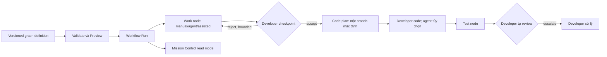

# Workflow/Pipeline và Mission Control cho AO

**Quyết định sản phẩm do người dùng nêu:** đây là hai năng lực mong muốn khi làm giàu AO. Tài liệu này là đặc tả hướng tích hợp, chưa phải code triển khai. 1DevTool mới được xác minh ở mức tài liệu chính thức + bundle, chưa qua runtime test.

**Use case ưu tiên:** [Tri thức dự án → thiết kế DDD → code trên worktree/branch → testing → review](./project-knowledge-ddd-workflow.md). Người dùng dựng graph, gán role/knowledge rồi Run theo [Flow Builder](./flow-builder.md); use case DDD là preset và định nghĩa artifact/gate cụ thể.

**Góc nhìn sử dụng:** preset đầu tiên là một Developer sở hữu một flow công việc. Core dùng [participant đa vai trò](./role-skill-knowledge-model.md), để cùng người/AI có thể đảm nhiệm PO, BA, SA, Dev, Test ở các bước khác nhau. Mỗi work node có thể do người tự làm, agent làm hoặc agent hỗ trợ; worker song song chỉ là lựa chọn khi công việc cần tách. Mission Control trước hết phải cho participant thấy việc đang ở bước nào, role đang đội và mình cần xử lý gì.

## 1. Bóc tách từ 1DevTool

| Năng lực | Hành vi tài liệu chính thức mô tả | Nguồn |
|---|---|---|
| Pipeline | Danh sách stage có thứ tự; mỗi stage chọn agent, model, brief và nhận output stage trước | https://1devtool.com/docs/en/orchestration/pipeline |
| Quality gate | Stage tiếp nhận có thể accept/reject handoff; reject giới hạn hai vòng mặc định rồi escalates | https://1devtool.com/docs/en/orchestration/pipeline |
| Charts/Builder | Canvas lưu preset hierarchy/pipeline, gắn role với terminal, có AI draft nhưng người dùng bấm Start | https://1devtool.com/docs/en/orchestration/builder |
| Mission Control | Panel trong project: Activity, Map, Runs, Logs; participant rail, trạng thái, attention, context usage | https://1devtool.com/docs/en/orchestration/mission-control |
| Recovery | Resume team, restore link context, relink/quarantine, báo prompt chưa gửi | https://1devtool.com/docs/en/orchestration/mission-control |
| Workflow visualization | Pipeline đang chạy có stage strip; run bị dừng vẫn có reason/log | https://1devtool.com/docs/en/orchestration/pipeline |

**Phân biệt:** Pipeline của 1DevTool được tài liệu mô tả là **chuỗi stage có thứ tự**. Nó chưa phải bằng chứng cho DAG tùy ý. Mission Control là **màn điều hành thời gian chạy**, còn Charts là **màn soạn định nghĩa**. Không gộp ba thứ thành một màn.

## 2. AO hiện có và khoảng trống

| AO hiện có tại `070b255ce2` | Bằng chứng code | Phần cần thêm |
|---|---|---|
| Orchestrator có thể delegate worker | `backend/internal/service/session/delegation.go`, `docs/STATUS.md` | Definition/run/stage rõ ràng, thứ tự và handoff có kiểm tra |
| Kanban trạng thái worker, PR/CI/review | `frontend/src/renderer/components/SessionsBoard.tsx`, `backend/internal/domain/status.go` | View theo **một mission/workflow** và quan hệ giữa worker |
| Automation định kỳ có run history | `backend/internal/domain/automation.go`, `service/automation` | Automation hiện là lịch chạy prompt/session, không phải stage pipeline |
| Chat approvals và notifications | `docs/STATUS.md`, domain conversation/notification | Gate cấp stage/handoff, decision audit, blocked action |
| Usage theo session/model | `backend/internal/domain/usage.go` | Tổng hợp usage/cost theo workflow run |

Tìm kiếm code tại HEAD không thấy các contract `workflow_definition`, `workflow_run`, `pipeline_run`, `step_run`, `quality_gate` hoặc `stage_id`. Đây là **chưa thấy model tương đương**, không khẳng định AO hoàn toàn không thể tạo workflow bằng orchestrator prompt.

## 3. Thiết kế đề xuất cho AO

### Domain và persistence

- `WorkflowDefinition`: project, version, node graph, edges, execution mode, role profile, skill versions, capabilities cần thiết, agent/model khi cần, knowledge binding, artifact schemas và gate policy. Version bất biến sau khi run bắt đầu.
- `WorkflowRun`: definition version, initiator, status, current stage, started/finished time. Không lưu trạng thái hiển thị suy diễn nếu AO đã có durable facts.
- `NodeRun`/`TaskRun`: node ID, participant/agent binding, AO session ID nếu là agent, attempt, input/output artifact refs, timestamps, failure reason; task sinh động có parent planner và revision.
- `HandoffDecision`: node run, accepted/rejected/needs-human, Developer ID, feedback, time. Reject count có trần; quá trần → Developer attention.
- `MissionReadModel`: projection từ workflow run + sessions + approvals + PR/CI + usage. Một nguồn state cho desktop/mobile.

Output giữa nodes nên dùng **artifact/ref có provenance** và bản tóm tắt có giới hạn, không ép toàn bộ transcript vào prompt kế tiếp. Node dùng agent thì đi qua Session Manager/worktree AO hiện có; node manual nhận artifact từ Developer. Định nghĩa workflow không được bypass Session Manager hoặc tạo controller thứ hai.

### Luồng UI

1. Project có lựa chọn **Board | Mission Control**. Board giữ cách nhìn tất cả worker theo vòng đời PR/CI; Mission Control tập trung một run/mission và các quan hệ.
2. `Create Workflow`: blank/template/AI draft, thêm node và dependency, gán role/agent/model, knowledge pack, gate và retry cap; validate, preview, save version, rồi người dùng bấm Run. Form editor là bản đầu; canvas kéo thả sau.
3. `Mission Control`: participant rail; stage strip; Needs you; Activity/Map/Runs/Logs; một click vào worker, gate hoặc lỗi. Chỉ tự mở nhẹ khi có run active; nhớ view theo project.
4. Recovery: retry stage, request changes, resume run và inspect failed handoff. Các action đi qua daemon API, có idempotency và audit.

### Backend boundary

- Go daemon sở hữu workflow definition/run/gates và scheduler. SQLite migration mới, query mới; không sửa migration đã merge.
- Controllers/API DTO và OpenAPI/types được regenerate theo `AGENTS.md`.
- Frontend chỉ render read model và gửi action; không lưu logic điều phối trong Electron main.
- CDC/SSE phát invalidation cho run/decision/participant; trạng thái được tính từ durable facts theo kiến trúc AO.
- Reaper/recovery phải phân biệt agent đang chờ người dùng, CLI tạm không phản hồi và process thật sự chết.

## 4. Thứ tự triển khai và tiêu chí chấp nhận

| Lát cắt | Kết quả thấy được | Tiêu chí chấp nhận |
|---|---|---|
| 0. Settings | Role/Skill versioned và Project Knowledge có preview nguồn | Flow Builder chọn lại được cấu hình; Run ghim version/hash, không đổi theo Settings mới |
| A. Mission Control V0 | View gộp sessions hiện có, attention, PR/CI, usage; chưa cần workflow engine | Click từ attention tới đúng worker; không sai trạng thái khi restart/project switch |
| B. Graph definition + run | Node/edge definition, role/knowledge binding, validator, run + handoff; DDD preset | Node phụ thuộc chỉ chạy khi đầu vào đạt gate; restart daemon không tạo duplicate worker |
| C. Quality gates | Accept/reject/feedback; cap retry; escalation | Không auto approve; feedback nguyên vẹn; quá retry cap dừng chờ người |
| D. Mission Control V1 | Stage strip, runs/logs, retry/recovery, tổng usage | Mọi action có trạng thái, lỗi và audit; desktop/mobile nhất quán |
| E. Builder nâng cao | Canvas kéo thả và plan revision khi run | Run luôn gắn đúng definition version; mọi revision có diff/audit; draft không tự start |

**Ưu tiên đề xuất:** Settings và Mission Control V0, rồi graph definition/run + gates, sau đó Mission Control V1. Canvas sau khi form editor và graph engine đã hoạt động. Mission Control V0 tận dụng AO hiện tại; Settings, Flow Builder và Run engine là phần AO cần xây.

## 5. Tác động lên kế hoạch cắt gọn

Đưa **Workflow/Pipeline** và **Mission Control** vào nhóm **GIỮ/PHÁT TRIỂN**. Giữ core project/session/worker/worktree, usage, notifications, PR/CI và approvals vì chúng là nguồn dữ liệu của Mission Control. Automation định kỳ là trigger có thể nối vào Workflow Run sau này, nhưng không thay thế Workflow Engine. Cloud, Device, importer rộng và công cụ dev không phải điều kiện tiên quyết cho hai tính năng này.
