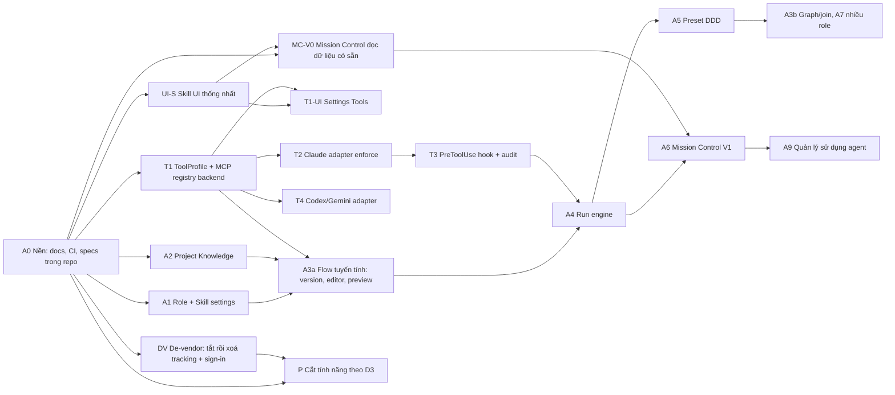

# Roadmap fork AO: Flow + Mission Control + Agent/Tool binding

> **For agentic workers:** Đây là bản đồ tổng, không phải plan để thực thi. Mỗi đợt có plan riêng (bảng §3). Thực thi plan bằng superpowers:subagent-driven-development hoặc superpowers:executing-plans. Đọc §5 (quy trình task) và §6 (scope cleanup) trước mọi task.

**Goal:** Biến fork `hainguyen97dev/ai-orchestrator` thành workspace cho một người đi hết vòng tri thức → DDD → code trên branch → test → review → giao kết quả. Mỗi bước chọn được agent, model, tool (builtin/MCP/shell) và theo dõi được trong Mission Control.

**Spec:** `../../../../feature-surgery/` (workspace, ngoài repo). Từ A0-T1 trở đi, bản sao nằm trong repo tại `docs/fork/specs/`. Worker chạy trong worktree chỉ thấy repo, nên đọc bản trong repo.

**Runner:** `ai-orchestra` (upstream AO, chạy từ bản ổn định) điều phối worker build fork này.

## 1. Quyết định đã chốt (mặc định, đổi được)

| ID | Quyết định | Giá trị |
|---|---|---|
| D1 | Mức tự động khi giao kết quả | 3 mức: `manual` / `auto-pr` / `auto-merge-when-gates-pass`. Dogfood dùng `auto-merge-when-gates-pass` cho PR rủi ro thấp (§7). |
| D2 | Pipeline | Tuyến tính trước, dựa trên `backend/internal/domain/pipeline.go` (commit `a7a41a1`). Graph/join làm ở A3b, chỉ thêm, không thay. |
| D3 | Cắt tính năng | Cloud/sharing: ẨN. Device: ẨN. Importer: chỉ Claude + Codex. Mobile: giữ, ngoài đường găng. Automation: GIỮ. Telemetry/Sentry: TẮT. Chỉ xoá code sau khi phân tích phụ thuộc (đợt P). |
| D4 | Tool | Gồm builtin, MCP và shell. Thứ tự: node → role → project; tầng dưới chỉ được thu hẹp. Adapter phải báo đúng mức `enforced` / `best-effort` / `none`. |
| D5 | Scope cleanup | Xong task phải dọn file ngoài kế hoạch hoặc lệch mục tiêu (§6). Về sau thành node `scope-check` trong Flow. |
| D6 | Agent | Mỗi task/node chọn harness, model, effort, permissions, account. Account hiện có: Claude `pro` (`device-claude`), Codex `plus` (`device-codex`). |
| D7 | Tracking + sign-in của nhà phát hành | Tắt rồi xoá: PostHog, Sentry, telemetry gửi ra ngoài, Cloud sign-in (WorkOS còn sót, control plane). Telemetry **local** (usage, metrics trong SQLite) giữ lại vì Mission Control/A9 cần. Làm ở đợt DV (§3); quy tắc thường trực ở §6a. |

## 2. Các phần và phụ thuộc



## 3. Danh mục plan

| Plan | Trạng thái | Lane | Agent đề xuất |
|---|---|---|---|
| [01 A0 Foundation](./2026-11-26-01-a0-foundation.md) | **Chi tiết, chạy đầu tiên** | Ops | Claude |
| [02 T1 ToolProfile + MCP backend](./2026-11-26-02-t1-tool-profiles.md) | **Chi tiết** | Contract | Codex |
| [03 UI-S Skill UI](./2026-11-26-03-ui-skill.md) | **Chi tiết** | UI | Claude |
| MC-V0, T1-UI | Viết plan khi UI-S xong | UI | Claude |
| [A1, A2](./2026-11-27-a1-a2.md) | **Chi tiết** ([contract](../../fork/specs/a1-a2-contract.md)) | Contract | Codex |
| T2, T3, T4 | Viết plan khi T1 merge | Adapter | Codex (T2/T4), Claude review |
| A3a, A4 | Viết plan khi A1/A2/T1 merge | Contract | Codex |
| A5, A6, A9, A3b/A7 | Viết plan khi A4 merge | Mixed | — |
| DV (de-vendor) | Viết plan ngay sau A0, chạy song song đợt 1. DV-1 kill switch (không còn gửi gì ra ngoài) → DV-2 xoá Sentry → DV-3 xoá PostHog/telemetry remote → DV-4 xoá sign-in/Cloud auth còn sót. Mỗi bước một PR | Prune | Claude phân tích, Codex xoá |
| P (cắt tính năng) | Viết plan sau A0; mỗi cụm một PR riêng | Prune | Claude phân tích, Codex xoá |

Plan chi tiết chỉ viết cho đợt sắp chạy. Đợt sau viết plan dựa trên code đã merge, để không bị lệch interface.

## 4. Chạy song song: lane, agent, giới hạn

**Lane** là luồng PR có thể chạy cùng lúc mà không đụng nhau:

| Lane | Phạm vi file | Agent |
|---|---|---|
| Contract | `domain/`, `service/`, `storage/sqlite/`, `httpd/controllers/`, `apispec/` | Codex (Go backend dài, cần TDD chặt) |
| Adapter | `adapters/agent/*`, `cli/hooks.go`, `ports/agent.go` | Codex |
| UI | `frontend/src/renderer/**`, `packages/product-ui/**` | Claude |
| Ops/Docs | `docs/`, `.github/`, `AGENTS.md`, skills | Claude |
| Review | read-only, review chéo | Claude review PR của Codex; Codex review PR của Claude |

**Giới hạn đồng thời (account thật: Claude `pro`, Codex `plus`):** mặc định **2 worker** (1 Claude + 1 Codex), tối đa **3** khi một session chỉ là review hoặc viết docs ngắn. Theo dõi quota trong trang Usage của ai-orchestra. Chạm cửa sổ quota thì dừng spawn mới; session đang chạy chuyển agent bằng `ao session switch`. Nâng gói thì tăng lên 3 worker + 1 reviewer. Không chạy 2 worker cùng lane trừ khi phạm vi file tách hẳn nhau.

**Hotspot phải chạy tuần tự** (mỗi lúc chỉ 1 PR đang mở đụng tới):
- `backend/internal/storage/sqlite/migrations/*` + `shippedMigrations` trong `migrate_burned_versions_test.go`
- `backend/internal/httpd/apispec/openapi.yaml`, `frontend/src/api/schema.ts`, `apispec/specgen/build.go`
- `backend/internal/daemon/daemon.go`, `backend/internal/httpd/api.go`

PR đụng hotspot vào **contract queue**: merge xong PR trước, PR sau mới `git rebase origin/main`, chạy lại `npm run sqlc && npm run api`, rồi push. Không resolve conflict bằng tay trong file generated.

**Cách giao task trong ai-orchestra:** mỗi task trong plan là một session. Prompt mẫu:

```text
Thực hiện Task <N> trong docs/superpowers/plans/<file>.md, đúng phạm vi Files của task.
Dùng superpowers:test-driven-development. Trước khi mở PR chạy superpowers:verification-before-completion
và bước Scope cleanup ở docs/superpowers/plans/2026-11-26-00-roadmap.md §6.
PR theo .agents/skills/pr-description/SKILL.md. Không đụng file ngoài Files nếu không ghi lý do trong PR.
```

Codex phải đọc được skill superpowers. Cài superpowers cho Codex (thư mục `~/.agents/skills/`), nếu không có thì prompt dẫn thẳng đường dẫn file skill.

## 5. Quy trình một task và skill dùng ở mỗi bước

| Bước | Skill / công cụ | Đầu ra |
|---|---|---|
| Chốt contract cho đợt mới (A1, A2, A3…) | superpowers:brainstorming → superpowers:writing-plans | Spec ngắn trong `docs/fork/specs/` + plan trong thư mục này |
| Cô lập | Worktree AO (mỗi session một worktree); superpowers:using-git-worktrees khi chạy ngoài AO | Branch `feat/<plan>-task-<n>` |
| Code | superpowers:test-driven-development | Test đỏ → xanh, commit nhỏ |
| Gặp lỗi | superpowers:systematic-debugging | Root cause trước khi sửa |
| UI | DESIGN.md + skill UI (plan 03) + `.agents/skills/ao-desktop-dev` (chạy app với `AO_DATA_DIR` riêng) | Screenshot trước/sau |
| Trước PR | superpowers:verification-before-completion + Scope cleanup (§6) | Lệnh đã chạy + output |
| PR | `.agents/skills/pr-description` | Mô tả có số liệu thay đổi và bằng chứng |
| Review | superpowers:requesting-code-review (reviewer chéo); superpowers:receiving-code-review khi sửa theo review | Không auto-accept góp ý chưa kiểm chứng |
| Kết thúc | superpowers:finishing-a-development-branch | Merge theo §7 |

## 6. Scope cleanup (bắt buộc trước khi mở PR)

1. `git diff --name-status origin/main...HEAD` → so với mục **Files** của task.
2. Mỗi file ngoài danh sách:
   - **Added** (A) không phục vụ mục tiêu task → `git rm` file đó.
   - **Modified** (M) không phục vụ mục tiêu → `git checkout origin/main -- <file>`.
   - Cần thật (ví dụ test helper, file generated từ source đã đổi) → giữ, ghi một dòng lý do trong PR mục "Out-of-plan files".
3. Không được xoá: file untracked mà task không tạo ra, worktree dirty đã đăng ký, migration đã merge, dữ liệu dưới `~/.ao`.
4. File generated (`gen/*`, `openapi.yaml`, `schema.ts`) chỉ hợp lệ khi source tương ứng (query/migration/dto/build.go) cũng có trong diff.
5. Chạy lại test của vùng bị ảnh hưởng sau khi dọn.

Trong sản phẩm, quy tắc này thành node `scope-check` (A4): so diff của branch với `CodePlan.fileScope`, liệt kê file ngoài phạm vi, cho participant chọn giữ/xoá/hoàn tác; mức `auto` thì tự hoàn tác file M và xoá file A, rồi chạy lại test node.

## 6a. Gặp tracking hoặc sign-in trong lúc làm task (quy tắc thường trực)

Code cần để ý: PostHog, Sentry, `AO_TELEMETRY_*` gửi ra ngoài, `AO_SENTRY_DSN`, `AO_CLOUD_CONTROL_PLANE_URL`, WorkOS/AuthKit, `cloud-client`, sign-in/device flow, mọi HTTP call tới domain của nhà phát hành.

1. Code đó nằm **trong file task đang sửa**, và tắt được bằng cách bỏ một lời gọi hoặc trả về no-op mà không đổi API → tắt luôn, ghi vào PR mục "De-vendor".
2. Ngoài phạm vi task, hoặc cần xoá rộng → **không** sửa trong task này (giữ đúng Scope cleanup §6). Thêm một dòng vào `docs/fork/devendor-log.md` (`file:line — cái gì — gửi đi đâu — đề xuất tắt/xoá`). Đợt DV xử lý theo log này.
3. Không bao giờ thêm code tracking hoặc sign-in mới. Reviewer chặn PR có import `posthog`, `@sentry/*`, `workos`.
4. Xoá phải đi theo lát dọc (UI → API → service → adapter → build/CI → docs/tests) và có test chứng minh không còn request ra ngoài (DV-1 tạo test này).

## 7. Policy merge khi dogfood

| Mức | Điều kiện | Ai merge |
|---|---|---|
| Auto | CI xanh, reviewer chéo approve, scope cleanup sạch, diff ≤ 400 dòng (không tính file generated), không đụng nhóm rủi ro | `gh pr merge --auto --squash` (GitHub merge khi CI pass) |
| Cần người | Đụng migration, `httpd/auth*`, `lan_listener*`, xoá tính năng (đợt P), đổi API contract đã merge, `.github/workflows` | Mày duyệt rồi merge |

Bảo vệ `main` của fork: required checks = các workflow giữ lại ở A0 Task 3; bật "Allow auto-merge". Thiết lập ở A0 Task 4, cần mày xác nhận trước khi chạy.
